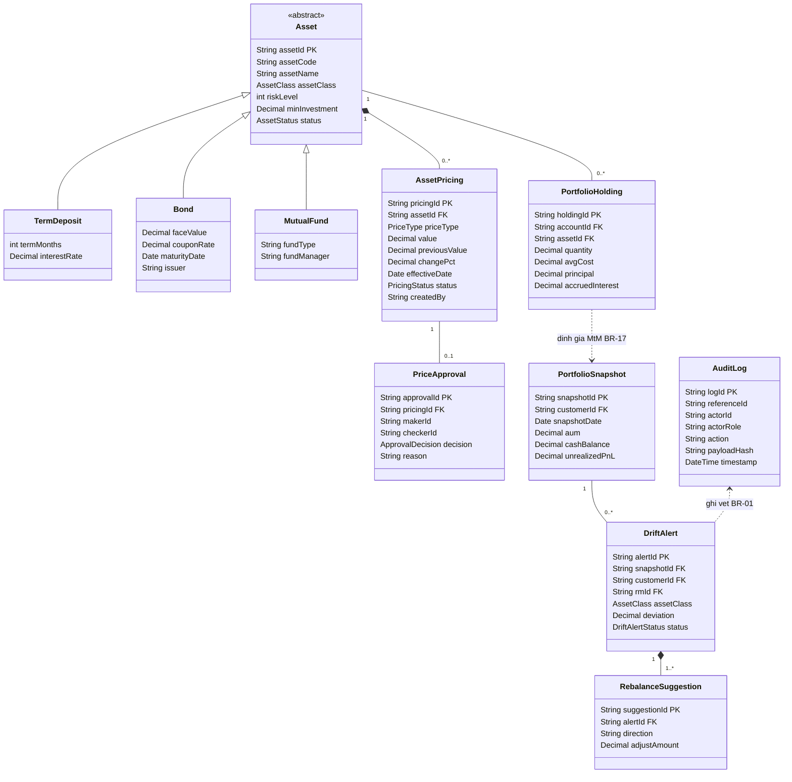
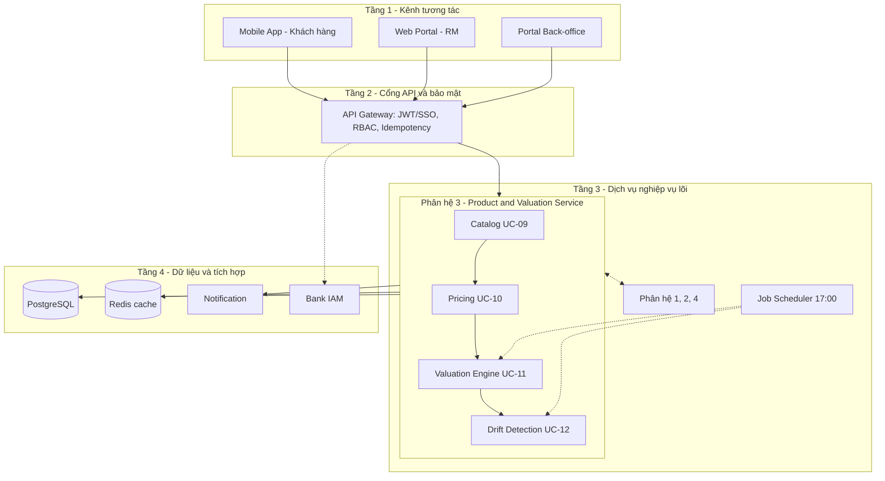

# Thiết kế Phân hệ 3 – Sản phẩm và Định giá danh mục

GitHub tự vẽ các sơ đồ Mermaid bên dưới khi bạn mở file này trên web.

## 1. Sơ đồ lớp

Lớp ngoài phân hệ chỉ tham chiếu qua khóa ngoại: `Customer`, `RM`, `RiskProfile` (Phân hệ 1) và `InvestmentAccount` (Phân hệ 2).

## 2. Kiến trúc hệ thống (4 tầng)

## 3. Quy tắc nghiệp vụ được kiểm thử

| Mã | Nội dung | Nơi cài đặt |
|---|---|---|
| BR-01 | Mọi thay đổi quan trọng đều ghi audit append-only | `PricingService` |
| BR-14 | `riskLevel` của sản phẩm từ 1 đến 5 | CSDL (ràng buộc CHECK), chưa có ở mã demo |
| BR-15 | Giá biến động trên 20% phải qua Maker-Checker | `PricingService` |
| BR-16 | Lệch tỷ trọng từ 5 điểm phần trăm thì cảnh báo | `DriftDetectionService` |
| BR-17 | AUM = tiền mặt + giá trị thị trường + gốc và lãi dự thu | `ValuationService` |

## 4. Giả định của bản demo

- Lãi dự thu của tiền gửi được tính vào lãi/lỗ chưa thực hiện.
- Thiếu giá APPLIED của CCQ hoặc trái phiếu thì báo lỗi, không dùng giá vốn thay thế.
- Redis chỉ lưu giá NAV mới nhất: đề xuất thiết kế, đặc tả gốc chỉ nêu Redis thuộc tầng dữ liệu.
- Tiền dùng `number` cho gọn; mã thật nên dùng `Decimal`.
